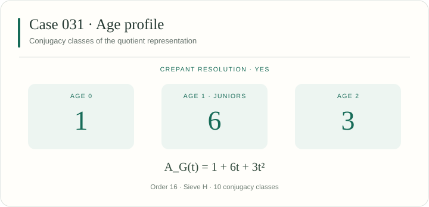
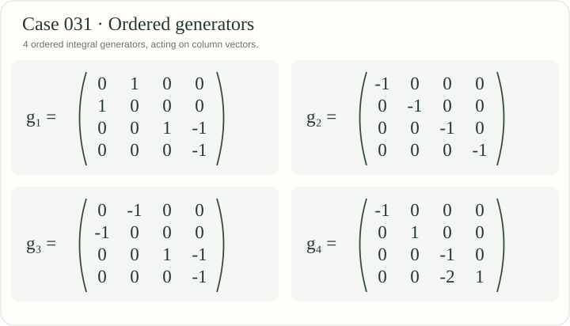

[← Case 030](../030/README.md) · [All 106 cases](../README.md) · [Case 032 →](../032/README.md)

# Case 031 · YES

A projective crepant resolution exists. Primary sieve: [H — A toric resolution and an involution](../../docs/methods.md#sieve-h).



## Invariants

| Invariant | Value |
|---|---|
| Group order $\lvert G\rvert$ | 16 |
| Junior conjugacy classes | 6 |
| Age-two conjugacy classes | 3 |
| Total conjugacy classes | 10 |
| Applicable sieves | [H](../../docs/methods.md#sieve-h) |
| Legacy source | [100](../../legacy245/catalogue.json) |
| All legacy integral representatives | 100, 101, 102, 103, 104 |
| CrystCat reference | System 18; Q-class 4; global Q-class 82 |

The age polynomial records conjugacy classes:

$$
A_G(t) = 1 + 6t + 3t^{2}.
$$

The displayed numbers count conjugacy classes by age, as in the manuscript. [Definition of the age polynomial](../../docs/catalogue.md#age-profiles).

## In the manuscript

The choice of the intermediate equivariant fan matters (CE-13).

## Exact generators

These ordered integral matrices define the displayed representation. The [matrix-transfer certificates](../../manuscript106/catalogue/conjugacy_certificates.json) identify all its legacy representatives.



<details>
<summary>Copyable matrix notation</summary>

```latex
g_{1}=\begin{pmatrix}0&1&0&0\\1&0&0&0\\0&0&1&-1\\0&0&0&-1\end{pmatrix}
```

```latex
g_{2}=\begin{pmatrix}-1&0&0&0\\0&-1&0&0\\0&0&-1&0\\0&0&0&-1\end{pmatrix}
```

```latex
g_{3}=\begin{pmatrix}0&-1&0&0\\-1&0&0&0\\0&0&1&-1\\0&0&0&-1\end{pmatrix}
```

```latex
g_{4}=\begin{pmatrix}-1&0&0&0\\0&1&0&0\\0&0&-1&0\\0&0&-2&1\end{pmatrix}
```

</details>

## Verify this case

Run from the repository root:

```sh
python3 verify.py --case 31 --plan
python3 verify.py --case 31 --output-dir ../sl4-results/case-031
```

The case runner combines its assigned legacy stages and extensions. Results are written to a new directory outside the checkout. The [full reproduction guide](../../docs/reproducibility.md) covers installation, shared checks, long computations and resumable runs.

<details>
<summary>Exact inputs, proof scope and additional checks</summary>

### Input files

[This case as JSON](case.json) · [Complete machine index](../index.json) · [245-to-106 reduction verifier](../../manuscript106/catalogue/verify_reduction.py)

- [manuscript106/catalogue/catalogue.json](../../manuscript106/catalogue/catalogue.json)
- [manuscript106/catalogue/catalogue_reduced.json](../../manuscript106/catalogue/catalogue_reduced.json)
- [manuscript106/catalogue/conjugacy_certificates.json](../../manuscript106/catalogue/conjugacy_certificates.json)
- [legacy245/catalogue.json](../../legacy245/catalogue.json)
- [legacy245/criteria_incidence.csv](../../legacy245/criteria_incidence.csv)
- [legacy245/criteria_geometry/README.md](../../legacy245/criteria_geometry/README.md)

### Applicable arguments

- **[Sieve H](../../docs/methods.md#sieve-h).** Identify the even-sign model, verify the coherent equivariant fan and the fixed-stratum calculation. Manuscript reference: `manuscript Sieve H`.

### Execution stages

`catalogue, criteria, representatives, criteria-geometry`

Some selected stages also check other cases. Cox cases run binding, full Cox generation and endpoint geometry in that order with the same exact inputs.

### Reading the result

Use the execution report to distinguish completed exact calculations from the cited geometric theorem inputs. The catalogue labels and this page are a navigation layer.

</details>

---

[← Case 030](../030/README.md) · [All 106 cases](../README.md) · [Case 032 →](../032/README.md)
