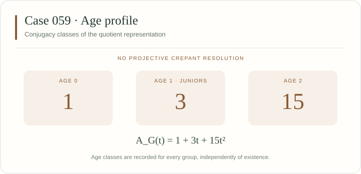

[← Case 058](../058/README.md) · [All 106 cases](../README.md) · [Case 060 →](../060/README.md)

# Case 059 · NO

No projective crepant resolution exists. Primary sieve: [A — Junior-generation obstruction](../../docs/methods.md#sieve-a).



## Invariants

| Invariant | Value |
|---|---|
| Group order $\lvert G\rvert$ | 96 |
| Junior conjugacy classes | 3 |
| Age-two conjugacy classes | 15 |
| Total conjugacy classes | 19 |
| Applicable sieves | [A](../../docs/methods.md#sieve-a) |
| Legacy source | [170](../../legacy245/catalogue.json) |
| All legacy integral representatives | 170 |
| CrystCat reference | System 33; Q-class 8; global Q-class 219 |

The age polynomial records conjugacy classes:

$$
A_G(t) = 1 + 3t + 15t^{2}.
$$

The displayed numbers count conjugacy classes by age, as in the manuscript. [Definition of the age polynomial](../../docs/catalogue.md#age-profiles).

## Exact generators

These ordered integral matrices define the displayed representation. The [matrix-transfer certificates](../../manuscript106/catalogue/conjugacy_certificates.json) identify all its legacy representatives.

$$
g_{1}=\begin{pmatrix}0&1&1&0\\-1&-1&-1&1\\1&1&1&0\\1&1&0&0\end{pmatrix}\qquad g_{2}=\begin{pmatrix}-1&0&0&0\\0&-1&0&0\\0&0&-1&0\\0&0&0&-1\end{pmatrix}.
$$

$$
g_{3}=\begin{pmatrix}1&1&0&0\\0&-1&0&0\\0&1&1&0\\0&0&0&-1\end{pmatrix}\qquad g_{4}=\begin{pmatrix}-1&0&0&0\\0&-1&0&0\\0&1&1&0\\0&1&0&1\end{pmatrix}.
$$

$$
g_{5}=\begin{pmatrix}0&-1&-1&-1\\0&1&2&0\\0&0&-1&0\\-1&-1&-1&0\end{pmatrix}\qquad g_{6}=\begin{pmatrix}0&1&1&1\\0&-1&0&-2\\-1&0&0&1\\0&1&0&1\end{pmatrix}.
$$

## Verify this case

Run from the repository root:

```sh
python3 verify.py --case 59 --plan
python3 verify.py --case 59 --output-dir ../sl4-results/case-059
```

The case runner combines its assigned legacy stages and extensions. Results are written to a new directory outside the checkout. The [full reproduction guide](../../docs/reproducibility.md) covers installation, shared checks, long computations and resumable runs.

<details>
<summary>Exact inputs, proof scope and additional checks</summary>

### Input files

[This case as JSON](case.json) · [Complete machine index](../index.json) · [245-to-106 reduction verifier](../../manuscript106/catalogue/verify_reduction.py)

- [manuscript106/catalogue/catalogue.json](../../manuscript106/catalogue/catalogue.json)
- [manuscript106/catalogue/catalogue_reduced.json](../../manuscript106/catalogue/catalogue_reduced.json)
- [manuscript106/catalogue/conjugacy_certificates.json](../../manuscript106/catalogue/conjugacy_certificates.json)
- [legacy245/catalogue.json](../../legacy245/catalogue.json)
- [legacy245/criteria_incidence.csv](../../legacy245/criteria_incidence.csv)

### Applicable arguments

- **[Sieve A](../../docs/methods.md#sieve-a).** Failure of generation by junior elements: compute the subgroup generated by every element with rank(g − I₄) = 2 and compare its order with the full group. Manuscript reference: `Yamagishi`.

### Execution stages

`catalogue, criteria, representatives`

Some selected stages also check other cases. Cox cases run binding, full Cox generation and endpoint geometry in that order with the same exact inputs.

### Reading the result

Use the execution report to distinguish completed exact calculations from the cited geometric theorem inputs. The catalogue labels and this page are a navigation layer.

</details>

---

[← Case 058](../058/README.md) · [All 106 cases](../README.md) · [Case 060 →](../060/README.md)
