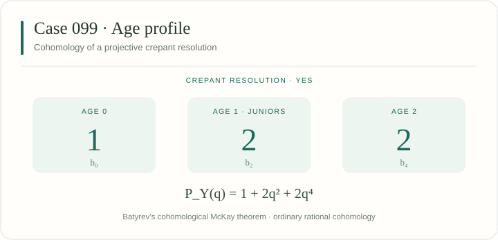

[← Case 098](../098/README.md) · [All 106 cases](../README.md) · [Case 100 →](../100/README.md)

# Case 099 · YES

A projective crepant resolution exists. Primary sieve: [E — Complete-intersection blow-ups](../../docs/methods.md#sieve-e).



## Invariants

| Invariant | Value |
|---|---|
| Group order $\lvert G\rvert$ | 60 |
| Junior conjugacy classes | 2 |
| Age-two conjugacy classes | 2 |
| Total conjugacy classes | 5 |
| Applicable sieves | [E](../../docs/methods.md#sieve-e) |
| Legacy source | [234](../../legacy245/catalogue.json) |
| All legacy integral representatives | 234, 235 |
| CrystCat reference | System 31; Q-class 3; global Q-class 186 |

The age polynomial records conjugacy classes:

$$
A_G(t) = 1 + 2t + 2t^{2}.
$$

The displayed numbers count conjugacy classes by age, as in the manuscript. [Definition of the age polynomial](../../docs/catalogue.md#age-profiles).

## Exact generators

These ordered integral matrices define the displayed representation. The [matrix-transfer certificates](../../manuscript106/catalogue/conjugacy_certificates.json) identify all its legacy representatives.

```math
g_{1}=\begin{pmatrix}
0 & 0 & 1 & 0 \\
0 & 1 & 0 & 0 \\
1 & 0 & 0 & 0 \\
-1 & -1 & -1 & -1
\end{pmatrix}
```

```math
g_{2}=\begin{pmatrix}
0 & 1 & 0 & 0 \\
0 & 0 & 0 & 1 \\
0 & 0 & 1 & 0 \\
1 & 0 & 0 & 0
\end{pmatrix}
```

## Verify this case

Run from the repository root:

```sh
python3 verify.py --case 99 --plan
python3 verify.py --case 99 --output-dir ../sl4-results/case-099
```

The case runner combines its assigned legacy stages and extensions. Results are written to a new directory outside the checkout. The [full reproduction guide](../../docs/reproducibility.md) covers installation, shared checks, long computations and resumable runs.

<details>
<summary>Exact inputs, proof scope and additional checks</summary>

### Input files

[This case as JSON](case.json) · [Complete machine index](../index.json) · [245-to-106 reduction verifier](../../manuscript106/catalogue/verify_reduction.py)

- [manuscript106/catalogue/catalogue.json](../../manuscript106/catalogue/catalogue.json)
- [manuscript106/catalogue/catalogue_reduced.json](../../manuscript106/catalogue/catalogue_reduced.json)
- [manuscript106/catalogue/conjugacy_certificates.json](../../manuscript106/catalogue/conjugacy_certificates.json)
- [legacy245/catalogue.json](../../legacy245/catalogue.json)
- [legacy245/criteria_incidence.csv](../../legacy245/criteria_incidence.csv)
- [legacy245/geometry_proofs/234](../../legacy245/geometry_proofs/234)

### Applicable arguments

- **[Sieve E](../../docs/methods.md#sieve-e).** Check complete invariant presentations and the stated blow-up charts, including the separate 132, 234 and 236 geometric packages. Manuscript reference: `manuscript Sieve E`.

### Execution stages

`catalogue, criteria, representatives, geometry, geometry-234`

Some selected stages also check other cases. Cox cases run binding, full Cox generation and endpoint geometry in that order with the same exact inputs.

### Included extensions

- **sieve-e.** Additional matrix-to-invariant-ring binding, blow-up chart and discrepancy checks from the current Sieve E audit. [Program](../../extensions/geometry/verify_E.py) (sage).

### Reading the result

Use the execution report to distinguish completed exact calculations from the cited geometric theorem inputs. The catalogue labels and this page are a navigation layer.

</details>

---

[← Case 098](../098/README.md) · [All 106 cases](../README.md) · [Case 100 →](../100/README.md)
