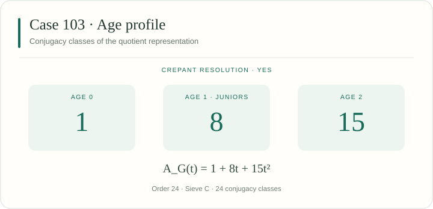

[← Case 102](../102/README.md) · [All 106 cases](../README.md) · [Case 104 →](../104/README.md)

# Case 103 · YES

A projective crepant resolution exists. Primary sieve: [C — Abelian junior-simplex geometry](../../docs/methods.md#sieve-c).



## Invariants

| Invariant | Value |
|---|---|
| Group order $\lvert G\rvert$ | 24 |
| Junior conjugacy classes | 8 |
| Age-two conjugacy classes | 15 |
| Total conjugacy classes | 24 |
| Applicable sieves | [C](../../docs/methods.md#sieve-c) |
| Legacy source | [240](../../legacy245/catalogue.json) |
| All legacy integral representatives | 240 |
| CrystCat reference | System 20; Q-class 5; global Q-class 94 |

The age polynomial records conjugacy classes:

$$
A_G(t) = 1 + 8t + 15t^{2}.
$$

For a projective crepant resolution $Y \to \mathbb{C}^4/G$, the ordinary rational Poincaré polynomial is

$$
P_Y(q) = 1 + 8q^{2} + 15q^{4}.
$$

Thus $(b_0,b_2,b_4)=(1,8,15)$; all odd Betti numbers and all $b_k$ with $k>4$ vanish. This follows from [Batyrev’s cohomological McKay theorem](../../docs/catalogue.md#age-profiles).

## Exact generators

These ordered integral matrices define the displayed representation. The [matrix-transfer certificates](../../manuscript106/catalogue/conjugacy_certificates.json) identify all its legacy representatives.

$$
g_{1}=\begin{pmatrix}-1&0&0&0\\0&-1&0&0\\0&0&1&0\\0&0&0&1\end{pmatrix}\qquad g_{2}=\begin{pmatrix}1&0&0&0\\0&1&0&0\\0&0&-1&0\\0&0&0&-1\end{pmatrix}.
$$

$$
g_{3}=\begin{pmatrix}1&0&0&0\\0&1&0&0\\0&0&0&1\\0&0&-1&0\end{pmatrix}\qquad g_{4}=\begin{pmatrix}0&-1&0&0\\1&-1&0&0\\0&0&1&0\\0&0&0&1\end{pmatrix}.
$$

## Verify this case

Run from the repository root:

```sh
python3 verify.py --case 103 --plan
python3 verify.py --case 103 --output-dir ../sl4-results/case-103
```

The case runner combines its assigned legacy stages and extensions. Results are written to a new directory outside the checkout. The [full reproduction guide](../../docs/reproducibility.md) covers installation, shared checks, long computations and resumable runs.

<details>
<summary>Exact inputs, proof scope and additional checks</summary>

### Input files

[This case as JSON](case.json) · [Complete machine index](../index.json) · [245-to-106 reduction verifier](../../manuscript106/catalogue/verify_reduction.py)

- [manuscript106/catalogue/catalogue.json](../../manuscript106/catalogue/catalogue.json)
- [manuscript106/catalogue/catalogue_reduced.json](../../manuscript106/catalogue/catalogue_reduced.json)
- [manuscript106/catalogue/conjugacy_certificates.json](../../manuscript106/catalogue/conjugacy_certificates.json)
- [legacy245/catalogue.json](../../legacy245/catalogue.json)
- [legacy245/criteria_incidence.csv](../../legacy245/criteria_incidence.csv)
- [legacy245/abelian_characters.csv](../../legacy245/abelian_characters.csv)
- [legacy245/240/triangulation.json](../../legacy245/240/triangulation.json)

### Applicable arguments

- **[Sieve C](../../docs/methods.md#sieve-c).** Bind the actual character lattice and check a coherent unimodular triangulation covering the complete junior simplex. Manuscript reference: `DHZ`.

### Execution stages

`catalogue, criteria, representatives, geometry`

Some selected stages also check other cases. Cox cases run binding, full Cox generation and endpoint geometry in that order with the same exact inputs.

### Included extensions

- **abelian-lattice.** Recompute the quotient lattice from the actual matrix character. [Program](../../extensions/abelian/verify.py) (python).

### Reading the result

Use the execution report to distinguish completed exact calculations from the cited geometric theorem inputs. The catalogue labels and this page are a navigation layer.

</details>

---

[← Case 102](../102/README.md) · [All 106 cases](../README.md) · [Case 104 →](../104/README.md)
