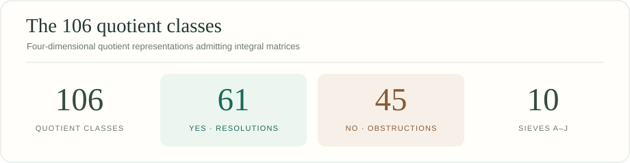

# All 106 quotient classes

[All 106](README.md) · [61 YES](yes.md) · [45 NO](no.md) · [Catalogue guide](../docs/catalogue.md) · [Sieves A–J](../docs/methods.md)

These are the **106 complex conjugacy classes admitting an integral representative** in $\mathrm{SL}_4(\mathbb{Z})$. Each card opens its exact matrices, age profile and verification command.

## Browse the cases

Green cards mark YES; brown cards mark NO. The letter names the primary sieve. The [full table](#full-table) lists every applicable sieve.

|  |  |  |  |  |  |  |  |  |  |
| :---: | :---: | :---: | :---: | :---: | :---: | :---: | :---: | :---: | :---: |
|  |  |  |  |  |  |  |  |  |  |
|  |  |  |  |  |  |  |  |  |  |
|  |  |  |  |  |  |  |  |  |  |
|  |  |  |  |  |  |  |  |  |  |
|  |  |  |  |  |  |  |  |  |  |
|  |  |  |  |  |  |  |  |  |  |
|  |  |  |  |  |  |  |  |  |  |
|  |  |  |  |  |  |  |  |  |  |
|  |  |  |  |  |  |  |  |  |  |
|  |  |  |  |  |  |  |  |  |  |
|  |  |  |  |  |  |  |  |  |  |

## Full table

| Case | Decision | Order | Juniors | Age two | Classes | Sieves | Legacy source | All legacy representatives | CrystCat (system, Q-class; global) |
|---|---|---:|---:|---:|---:|---|---:|---|---|
| [001](001/README.md) | YES | 1 | 0 | 0 | 1 | [B](../docs/methods.md#sieve-b), [C](../docs/methods.md#sieve-c) | 1 | 1 | (1, 1; 1) |
| [002](002/README.md) | NO | 2 | 0 | 1 | 2 | [A](../docs/methods.md#sieve-a) | 2 | 2 | (1, 2; 2) |
| [003](003/README.md) | YES | 2 | 1 | 0 | 2 | [B](../docs/methods.md#sieve-b), [C](../docs/methods.md#sieve-c) | 3 | 3, 4, 5 | (3, 1; 6) |
| [004](004/README.md) | NO | 3 | 0 | 2 | 3 | [A](../docs/methods.md#sieve-a) | 6 | 6 | (11, 1; 37) |
| [005](005/README.md) | YES | 3 | 2 | 0 | 3 | [B](../docs/methods.md#sieve-b), [C](../docs/methods.md#sieve-c) | 7 | 7, 8 | (8, 1; 24) |
| [006](006/README.md) | NO | 4 | 0 | 3 | 4 | [A](../docs/methods.md#sieve-a) | 9 | 9 | (10, 1; 36) |
| [007](007/README.md) | YES | 4 | 2 | 1 | 4 | [C](../docs/methods.md#sieve-c) | 10 | 10, 11, 12 | (3, 2; 7) |
| [008](008/README.md) | YES | 4 | 3 | 0 | 4 | [B](../docs/methods.md#sieve-b), [C](../docs/methods.md#sieve-c) | 13 | 13, 14, 15, 16, 17, 18, 19, 20, 21, 22, 23, 24, 25 | (5, 1; 12) |
| [009](009/README.md) | YES | 4 | 3 | 0 | 4 | [B](../docs/methods.md#sieve-b), [C](../docs/methods.md#sieve-c) | 26 | 26, 27 | (7, 2; 18) |
| [010](010/README.md) | NO | 4 | 1 | 2 | 4 | [A](../docs/methods.md#sieve-a) | 28 | 28, 29 | (7, 1; 17) |
| [011](011/README.md) | NO | 6 | 0 | 5 | 6 | [A](../docs/methods.md#sieve-a) | 30 | 30 | (11, 2; 38) |
| [012](012/README.md) | NO | 6 | 2 | 3 | 6 | [A](../docs/methods.md#sieve-a) | 31 | 31, 32 | (8, 2; 25) |
| [013](013/README.md) | YES | 6 | 2 | 0 | 3 | [B](../docs/methods.md#sieve-b) | 33 | 33, 34, 35, 36, 37, 38, 39, 40 | (14, 3; 56) |
| [014](014/README.md) | YES | 6 | 1 | 1 | 3 | [D](../docs/methods.md#sieve-d) | 41 | 41, 42, 43 | (17, 1; 77) |
| [015](015/README.md) | YES | 9 | 4 | 4 | 9 | [C](../docs/methods.md#sieve-c) | 44 | 44, 45 | (22, 1; 116) |
| [016](016/README.md) | NO | 8 | 0 | 4 | 5 | [A](../docs/methods.md#sieve-a) | 46 | 46, 47 | (32, 1; 191) |
| [017](017/README.md) | YES | 8 | 6 | 1 | 8 | [C](../docs/methods.md#sieve-c) | 48 | 48, 49, 50, 51, 52, 53, 54, 55, 56 | (5, 2; 13) |
| [018](018/README.md) | NO | 8 | 2 | 5 | 8 | [A](../docs/methods.md#sieve-a) | 57 | 57, 58, 59 | (18, 1; 79) |
| [019](019/README.md) | YES | 8 | 2 | 2 | 5 | [D](../docs/methods.md#sieve-d) | 60 | 60, 61, 62 | (16, 1; 76) |
| [020](020/README.md) | YES | 8 | 4 | 3 | 8 | [C](../docs/methods.md#sieve-c) | 63 | 63, 64 | (7, 3; 19) |
| [021](021/README.md) | NO | 8 | 0 | 7 | 8 | [A](../docs/methods.md#sieve-a) | 65 | 65 | (26, 1; 154) |
| [022](022/README.md) | YES | 8 | 4 | 0 | 5 | [B](../docs/methods.md#sieve-b) | 66 | 66, 67, 68, 69, 70, 71 | (13, 4; 47) |
| [023](023/README.md) | YES | 8 | 3 | 1 | 5 | [E](../docs/methods.md#sieve-e) | 72 | 72, 73, 74, 75, 76, 77 | (13, 3; 46) |
| [024](024/README.md) | YES | 12 | 3 | 0 | 4 | [B](../docs/methods.md#sieve-b) | 78 | 78, 79, 80, 81, 82, 83 | (24, 1; 138) |
| [025](025/README.md) | NO | 12 | 0 | 11 | 12 | [A](../docs/methods.md#sieve-a) | 84 | 84 | (28, 1; 160) |
| [026](026/README.md) | YES | 12 | 3 | 2 | 6 | [E](../docs/methods.md#sieve-e) | 85 | 85, 86, 87, 88 | (14, 5; 58) |
| [027](027/README.md) | NO | 12 | 2 | 3 | 6 | [D](../docs/methods.md#sieve-d) | 89 | 89, 90 | (17, 2; 78) |
| [028](028/README.md) | YES | 18 | 3 | 2 | 6 | [F](../docs/methods.md#sieve-f) | 91 | 91, 92, 93, 94, 95 | (22, 5; 120) |
| [029](029/README.md) | NO | 18 | 4 | 13 | 18 | [A](../docs/methods.md#sieve-a) | 96 | 96, 97 | (22, 2; 117) |
| [030](030/README.md) | NO | 16 | 3 | 6 | 10 | [D](../docs/methods.md#sieve-d) | 98 | 98, 99 | (32, 4; 194) |
| [031](031/README.md) | YES | 16 | 6 | 3 | 10 | [H](../docs/methods.md#sieve-h) | 100 | 100, 101, 102, 103, 104 | (18, 4; 82) |
| [032](032/README.md) | YES | 16 | 6 | 9 | 16 | [C](../docs/methods.md#sieve-c) | 105 | 105, 106 | (19, 2; 85) |
| [033](033/README.md) | YES | 16 | 7 | 2 | 10 | [F](../docs/methods.md#sieve-f) | 107 | 107, 108, 109, 110, 111 | (13, 9; 52) |
| [034](034/README.md) | NO | 16 | 1 | 8 | 10 | [A](../docs/methods.md#sieve-a) | 112 | 112, 113 | (32, 2; 192) |
| [035](035/README.md) | YES | 16 | 2 | 4 | 7 | [I](../docs/methods.md#sieve-i) | 114 | 114 | (26, 2; 155) |
| [036](036/README.md) | NO | 16 | 1 | 5 | 7 | [A](../docs/methods.md#sieve-a) | 115 | 115, 116 | (32, 3; 193) |
| [037](037/README.md) | NO | 24 | 0 | 6 | 7 | [A](../docs/methods.md#sieve-a) | 117 | 117 | (33, 3; 214) |
| [038](038/README.md) | YES | 24 | 2 | 4 | 7 | [D](../docs/methods.md#sieve-d) | 118 | 118, 119, 120 | (32, 5; 195) |
| [039](039/README.md) | NO | 24 | 0 | 14 | 15 | [A](../docs/methods.md#sieve-a) | 121 | 121 | (33, 1; 212) |
| [040](040/README.md) | YES | 24 | 4 | 0 | 5 | [B](../docs/methods.md#sieve-b) | 126 | 122, 123, 124, 125, 126 | (25, 3; 145) |
| [041](041/README.md) | YES | 24 | 3 | 1 | 5 | [F](../docs/methods.md#sieve-f) | 127 | 127, 128, 129, 130, 131 | (25, 4; 146) |
| [042](042/README.md) | YES | 24 | 4 | 3 | 8 | [E](../docs/methods.md#sieve-e) | 132 | 132, 133, 134, 135, 136, 137 | (24, 2; 139) |
| [043](043/README.md) | NO | 24 | 2 | 6 | 9 | [I](../docs/methods.md#sieve-i) | 138 | 138 | (28, 2; 161) |
| [044](044/README.md) | NO | 24 | 0 | 11 | 12 | [A](../docs/methods.md#sieve-a) | 139 | 139 | (33, 2; 213) |
| [045](045/README.md) | NO | 36 | 4 | 7 | 12 | [I](../docs/methods.md#sieve-i) | 140 | 140, 141, 142 | (22, 7; 122) |
| [046](046/README.md) | YES | 32 | 9 | 7 | 17 | [I](../docs/methods.md#sieve-i) | 143 | 143, 144 | (32, 10; 200) |
| [047](047/README.md) | YES | 32 | 8 | 5 | 14 | [F](../docs/methods.md#sieve-f) | 145 | 145, 146 | (19, 5; 88) |
| [048](048/README.md) | NO | 32 | 3 | 7 | 11 | [A](../docs/methods.md#sieve-a) | 147 | 147, 148 | (32, 7; 197) |
| [049](049/README.md) | YES | 32 | 4 | 9 | 14 | [D](../docs/methods.md#sieve-d) | 149 | 149, 150 | (32, 8; 198) |
| [050](050/README.md) | YES | 32 | 4 | 6 | 11 | [I](../docs/methods.md#sieve-i) | 151 | 151, 152 | (32, 6; 196) |
| [051](051/README.md) | NO | 48 | 1 | 12 | 14 | [A](../docs/methods.md#sieve-a) | 153 | 153 | (33, 5; 216) |
| [052](052/README.md) | YES | 48 | 6 | 3 | 10 | [G](../docs/methods.md#sieve-g) | 154 | 154, 155, 156, 157, 158 | (25, 6; 148) |
| [053](053/README.md) | NO | 48 | 1 | 6 | 8 | [D](../docs/methods.md#sieve-d) | 159 | 159 | (33, 6; 217) |
| [054](054/README.md) | NO | 48 | 1 | 10 | 12 | [A](../docs/methods.md#sieve-a) | 160 | 160 | (33, 4; 215) |
| [055](055/README.md) | YES | 48 | 2 | 5 | 8 | [I](../docs/methods.md#sieve-i) | 161 | 161, 162, 163 | (32, 11; 201) |
| [056](056/README.md) | NO | 72 | 4 | 16 | 21 | [D](../docs/methods.md#sieve-d) | 164 | 164 | (33, 7; 218) |
| [057](057/README.md) | YES | 64 | 7 | 8 | 16 | [J](../docs/methods.md#sieve-j) | 165 | 165, 166 | (32, 12; 202) |
| [058](058/README.md) | YES | 96 | 5 | 5 | 11 | [I](../docs/methods.md#sieve-i) | 167 | 167, 168, 169 | (32, 16; 206) |
| [059](059/README.md) | NO | 96 | 3 | 15 | 19 | [A](../docs/methods.md#sieve-a) | 170 | 170 | (33, 8; 219) |
| [060](060/README.md) | NO | 96 | 3 | 9 | 13 | [I](../docs/methods.md#sieve-i) | 171 | 171 | (33, 9; 220) |
| [061](061/README.md) | NO | 96 | 3 | 12 | 16 | [D](../docs/methods.md#sieve-d) | 172 | 172 | (33, 10; 221) |
| [062](062/README.md) | NO | 144 | 3 | 11 | 15 | [I](../docs/methods.md#sieve-i) | 173 | 173 | (33, 11; 222) |
| [063](063/README.md) | YES | 192 | 5 | 7 | 13 | [I](../docs/methods.md#sieve-i) | 174 | 174, 175, 176 | (32, 20; 210) |
| [064](064/README.md) | YES | 192 | 4 | 12 | 17 | [I](../docs/methods.md#sieve-i) | 177 | 177 | (33, 12; 223) |
| [065](065/README.md) | NO | 288 | 5 | 19 | 25 | [I](../docs/methods.md#sieve-i) | 178 | 178 | (33, 13; 224) |
| [066](066/README.md) | NO | 576 | 5 | 14 | 20 | [I](../docs/methods.md#sieve-i) | 179 | 179 | (33, 15; 226) |
| [067](067/README.md) | YES | 6 | 5 | 0 | 6 | [B](../docs/methods.md#sieve-b), [C](../docs/methods.md#sieve-c) | 180 | 180 | (9, 1; 29) |
| [068](068/README.md) | YES | 6 | 3 | 2 | 6 | [C](../docs/methods.md#sieve-c) | 181 | 181 | (9, 2; 30) |
| [069](069/README.md) | NO | 6 | 1 | 4 | 6 | [A](../docs/methods.md#sieve-a) | 182 | 182, 183 | (21, 1; 112) |
| [070](070/README.md) | NO | 12 | 0 | 5 | 6 | [A](../docs/methods.md#sieve-a) | 184 | 184 | (30, 1; 171) |
| [071](071/README.md) | NO | 12 | 2 | 9 | 12 | [A](../docs/methods.md#sieve-a) | 185 | 185, 186 | (21, 2; 113) |
| [072](072/README.md) | YES | 12 | 6 | 5 | 12 | [C](../docs/methods.md#sieve-c) | 187 | 187 | (9, 3; 31) |
| [073](073/README.md) | YES | 12 | 5 | 0 | 6 | [B](../docs/methods.md#sieve-b) | 188 | 188, 189 | (15, 4; 67) |
| [074](074/README.md) | YES | 12 | 4 | 1 | 6 | [F](../docs/methods.md#sieve-f) | 190 | 190, 191, 192, 193 | (15, 5; 68) |
| [075](075/README.md) | YES | 12 | 3 | 2 | 6 | [I](../docs/methods.md#sieve-i) | 194 | 194, 195, 196, 197 | (21, 3; 114) |
| [076](076/README.md) | YES | 18 | 7 | 10 | 18 | [C](../docs/methods.md#sieve-c) | 198 | 198 | (23, 1; 127) |
| [077](077/README.md) | YES | 18 | 3 | 5 | 9 | [D](../docs/methods.md#sieve-d) | 199 | 199, 200, 201 | (29, 1; 162) |
| [078](078/README.md) | NO | 24 | 2 | 6 | 9 | [D](../docs/methods.md#sieve-d) | 202 | 202, 203 | (30, 4; 174) |
| [079](079/README.md) | YES | 24 | 8 | 3 | 12 | [F](../docs/methods.md#sieve-f) | 204 | 204, 205 | (15, 11; 74) |
| [080](080/README.md) | YES | 24 | 6 | 5 | 12 | [I](../docs/methods.md#sieve-i) | 206 | 206, 207 | (21, 4; 115) |
| [081](081/README.md) | NO | 24 | 2 | 12 | 15 | [A](../docs/methods.md#sieve-a) | 208 | 208 | (30, 3; 173) |
| [082](082/README.md) | NO | 24 | 2 | 9 | 12 | [A](../docs/methods.md#sieve-a) | 209 | 209 | (30, 2; 172) |
| [083](083/README.md) | YES | 36 | 10 | 25 | 36 | [C](../docs/methods.md#sieve-c) | 210 | 210 | (23, 2; 128) |
| [084](084/README.md) | NO | 36 | 4 | 13 | 18 | [D](../docs/methods.md#sieve-d) | 211 | 211, 212 | (29, 2; 163) |
| [085](085/README.md) | NO | 36 | 2 | 15 | 18 | [A](../docs/methods.md#sieve-a) | 213 | 213 | (30, 5; 175) |
| [086](086/README.md) | YES | 36 | 4 | 4 | 9 | [J](../docs/methods.md#sieve-j) | 214 | 214, 215, 216, 217, 218 | (29, 3; 164) |
| [087](087/README.md) | YES | 36 | 6 | 5 | 12 | [F](../docs/methods.md#sieve-f) | 219 | 219, 220 | (23, 5; 131) |
| [088](088/README.md) | YES | 48 | 6 | 8 | 15 | [I](../docs/methods.md#sieve-i) | 221 | 221 | (30, 6; 176) |
| [089](089/README.md) | YES | 72 | 7 | 10 | 18 | [I](../docs/methods.md#sieve-i) | 222 | 222, 223 | (29, 5; 166) |
| [090](090/README.md) | YES | 72 | 10 | 13 | 24 | [F](../docs/methods.md#sieve-f) | 224 | 224 | (23, 8; 134) |
| [091](091/README.md) | NO | 72 | 3 | 14 | 18 | [A](../docs/methods.md#sieve-a) | 225 | 225 | (30, 9; 179) |
| [092](092/README.md) | YES | 72 | 6 | 20 | 27 | [D](../docs/methods.md#sieve-d) | 226 | 226 | (30, 7; 177) |
| [093](093/README.md) | NO | 72 | 3 | 11 | 15 | [I](../docs/methods.md#sieve-i) | 227 | 227 | (30, 8; 178) |
| [094](094/README.md) | YES | 144 | 8 | 15 | 24 | [J](../docs/methods.md#sieve-j) | 228 | 228 | (30, 10; 180) |
| [095](095/README.md) | NO | 5 | 0 | 4 | 5 | [A](../docs/methods.md#sieve-a) | 229 | 229 | (27, 1; 156) |
| [096](096/README.md) | NO | 10 | 0 | 9 | 10 | [A](../docs/methods.md#sieve-a) | 230 | 230 | (27, 2; 157) |
| [097](097/README.md) | YES | 10 | 1 | 2 | 4 | [I](../docs/methods.md#sieve-i) | 231 | 231, 232 | (27, 3; 158) |
| [098](098/README.md) | YES | 20 | 2 | 5 | 8 | [I](../docs/methods.md#sieve-i) | 233 | 233 | (27, 4; 159) |
| [099](099/README.md) | YES | 60 | 2 | 2 | 5 | [E](../docs/methods.md#sieve-e) | 234 | 234, 235 | (31, 3; 186) |
| [100](100/README.md) | YES | 120 | 3 | 6 | 10 | [E](../docs/methods.md#sieve-e) | 236 | 236, 237 | (31, 6; 189) |
| [101](101/README.md) | YES | 12 | 5 | 6 | 12 | [C](../docs/methods.md#sieve-c) | 238 | 238 | (20, 1; 90) |
| [102](102/README.md) | NO | 12 | 3 | 8 | 12 | [A](../docs/methods.md#sieve-a) | 239 | 239 | (20, 2; 91) |
| [103](103/README.md) | YES | 24 | 8 | 15 | 24 | [C](../docs/methods.md#sieve-c) | 240 | 240 | (20, 5; 94) |
| [104](104/README.md) | YES | 24 | 5 | 3 | 9 | [F](../docs/methods.md#sieve-f) | 241 | 241, 242 | (20, 7; 96) |
| [105](105/README.md) | NO | 24 | 4 | 4 | 9 | [I](../docs/methods.md#sieve-i) | 243 | 243, 244 | (20, 11; 100) |
| [106](106/README.md) | YES | 48 | 9 | 8 | 18 | [F](../docs/methods.md#sieve-f) | 245 | 245 | (20, 19; 108) |

The age columns count conjugacy classes. For YES cases, $(1,\mathrm{juniors},\mathrm{age\ two})=(b_0,b_2,b_4)$ for a projective crepant resolution. [Interpretation and theorem](../docs/catalogue.md#age-profiles).
